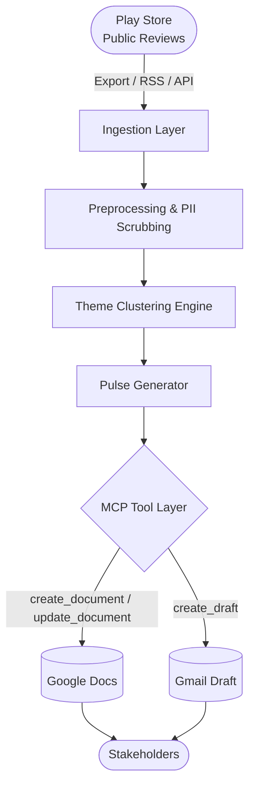
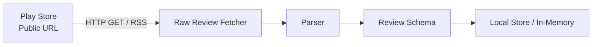
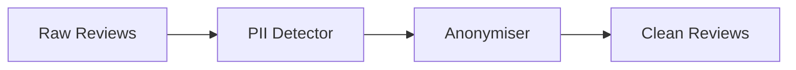
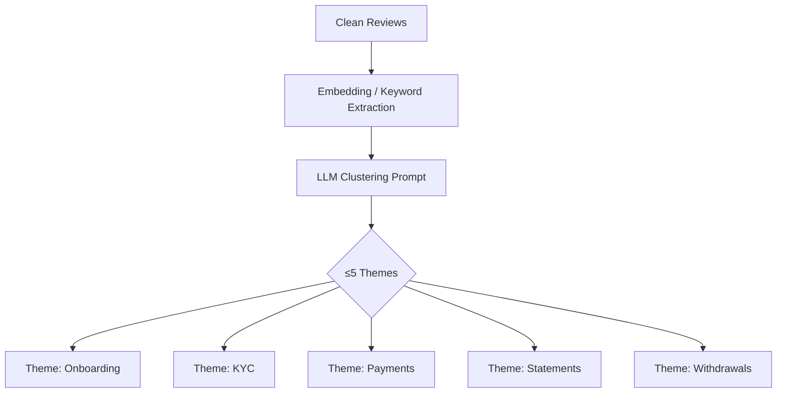
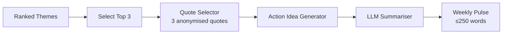
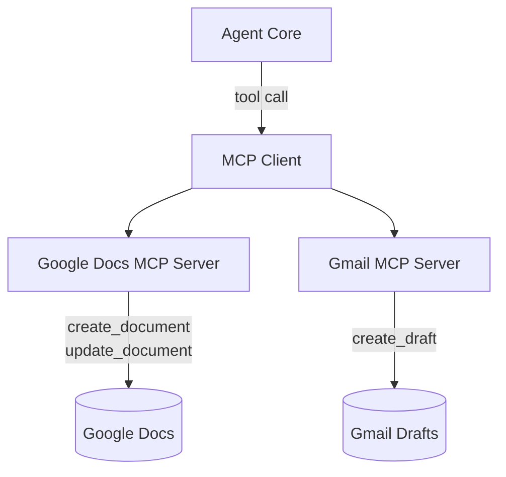
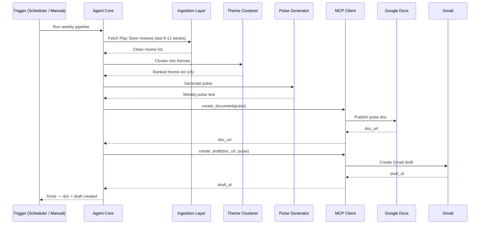

# Architecture — Groww App Review Intelligence Agent

> Derived from [ProblemStatement.md](./ProblemStatement.md)

---

## 1. System Overview

The Groww Review Intelligence Agent is an **AI-powered pipeline** that ingests raw user reviews from the Play Store, runs LLM-assisted theme clustering and summarization, and delivers a weekly pulse to stakeholders via Google Docs and Gmail — all orchestrated through MCP (Model Context Protocol) tool servers.



---

## 2. High-Level Component Map

| Layer | Component | Responsibility |
|---|---|---|
| **Data** | Review Ingester | Fetch & parse raw reviews |
| **Data** | PII Scrubber | Strip usernames, device IDs, identifiable info |
| **Intelligence** | Theme Clusterer | Group reviews into ≤5 themes |
| **Intelligence** | Pulse Generator | Produce the one-page weekly note |
| **Integration** | MCP Client | Orchestrate calls to Docs & Gmail MCP servers |
| **Delivery** | Google Docs MCP Server | Publish pulse document |
| **Delivery** | Gmail MCP Server | Create draft email with pulse / link |
| **Orchestration** | Agent Core | Coordinate the full pipeline end-to-end |

---

## 3. Detailed Component Architecture

### 3.1 Review Ingestion Layer



**Responsibilities:**
- Fetch reviews from the past **8–12 weeks** using public, ToS-compliant sources only.
- Parse into a normalized schema.
- No authentication, no scraping behind store logins.

**Review Schema:**
```json
{
  "id":     "unique-review-id",
  "rating": 1-5,
  "title":  "string | null",
  "text":   "string",
  "date":   "ISO-8601"
}
```

---

### 3.2 Preprocessing & PII Scrubbing



**Transformations applied:**
- Remove reviewer display names / usernames.
- Mask or drop email addresses, phone numbers, device IDs.
- Normalize whitespace and encoding.
- Flag and exclude reviews shorter than a configurable minimum length.

> **Constraint:** No identifiable reviewer data may appear in any downstream artifact.

---

### 3.3 Theme Clustering Engine



**Approach:**
- Use an LLM (e.g. Gemini / GPT-4o) with a structured prompt to cluster reviews into at most **5 named themes**.
- Each review is assigned exactly one primary theme.
- Themes are ranked by review volume (count of reviews per theme).

**Output Schema:**
```json
{
  "themes": [
    {
      "name":        "Payments",
      "review_count": 42,
      "top_quotes":  ["quote1", "quote2", "quote3"],
      "sentiment":   "negative | neutral | positive"
    }
  ]
}
```

---

### 3.4 Pulse Generator



**Responsibilities:**
- Pick the **top 3 themes** by review volume.
- Select **3 verbatim, anonymized user quotes** (one per top theme).
- Generate **3 action ideas** grounded in the top themes using LLM reasoning.
- Assemble the final one-page note within the **≤ 250 word** limit.

**Pulse Template:**
```
# Groww Weekly Review Pulse — [Week of DATE]

## Top Themes
1. [Theme 1] — N reviews
2. [Theme 2] — N reviews
3. [Theme 3] — N reviews

## What Users Are Saying
> "[Quote 1]"
> "[Quote 2]"
> "[Quote 3]"

## Recommended Actions
1. [Action Idea 1]
2. [Action Idea 2]
3. [Action Idea 3]
```

---

### 3.5 MCP Integration Layer



**Design Principles:**
- **MCP-first:** All Google Workspace interactions go through MCP tool servers — no raw OAuth flows or REST clients in application code.
- The MCP Client is a thin wrapper that serializes tool calls and handles responses.
- Auth and HTTP plumbing are entirely owned by the MCP server layer.

**MCP Tools Used:**

| Tool | Server | Purpose |
|---|---|---|
| `create_document` | Google Docs MCP | Create a new pulse document |
| `update_document` | Google Docs MCP | Update existing doc on re-run |
| `create_draft` | Gmail MCP | Create a Gmail draft with pulse / doc link |

---

### 3.6 Agent Core (Orchestrator)



---

## 4. Folder Structure

```
AI Agent/
├── Docs/
│   ├── ProblemStatement.md
│   └── Architecture.md             ← this file
├── src/
│   ├── agent/
│   │   └── core.py                 # Orchestrator — runs the full pipeline
│   ├── ingestion/
│   │   ├── fetcher.py              # Fetches raw reviews from Play Store
│   │   ├── parser.py               # Parses into Review schema
│   │   └── scrubber.py             # PII removal & anonymisation
│   ├── intelligence/
│   │   ├── clusterer.py            # LLM-assisted theme clustering
│   │   └── pulse_generator.py      # One-page pulse assembly
│   ├── mcp/
│   │   ├── client.py               # MCP Client wrapper
│   │   ├── docs_tools.py           # Google Docs MCP tool calls
│   │   └── gmail_tools.py          # Gmail MCP tool calls
│   └── utils/
│       ├── config.py               # App config (review window, theme limit, etc.)
│       └── logger.py               # Structured logging
├── tests/
│   ├── test_ingestion.py
│   ├── test_clusterer.py
│   ├── test_pulse_generator.py
│   └── test_mcp_client.py
├── config/
│   └── settings.yaml               # Configurable params (window, theme cap, word limit)
├── requirements.txt
└── README.md
```

---

## 5. Configuration Parameters

| Parameter | Default | Description |
|---|---|---|
| `review_window_weeks` | `10` | How many weeks of reviews to ingest |
| `max_themes` | `5` | Maximum number of clusters |
| `pulse_themes` | `3` | Top N themes to feature in pulse |
| `pulse_max_words` | `250` | Hard cap on pulse word count |
| `quotes_per_pulse` | `3` | Number of user quotes in pulse |
| `action_ideas_count` | `3` | Number of action ideas to generate |
| `min_review_length` | `20` | Min characters to include a review |

---

## 6. Data Flow Summary

```
Play Store (public)
      │
      ▼
[Raw Reviews]  ──── rating, title, text, date
      │
      ▼
[PII Scrubber]  ─── strips usernames, emails, device IDs
      │
      ▼
[Theme Clusterer] ─ ≤5 themes, ranked by volume
      │
      ▼
[Pulse Generator] ─ Top 3 themes + 3 quotes + 3 actions → ≤250 words
      │
      ├──► [Google Docs MCP] ─ creates / updates pulse document
      │
      └──► [Gmail MCP] ──────── creates draft email with doc link
```

---

## 7. Key Design Decisions

| Decision | Rationale |
|---|---|
| **MCP-first integration** | Avoids bespoke OAuth/REST client code; keeps auth centralized in MCP server |
| **LLM for clustering** | Semantic grouping is more robust than keyword matching for noisy review text |
| **≤5 theme hard cap** | Forces meaningful grouping and keeps the pulse digestible |
| **PII scrubbing before LLM** | Prevents accidental leakage of reviewer identity into prompts or outputs |
| **Verbatim quotes** | Preserves authentic user voice; no paraphrasing or invented wording |
| **≤250-word pulse** | Ensures leadership can scan the output in under 2 minutes |

---

## 8. Constraints Enforced by Architecture

| Constraint | Enforced Where |
|---|---|
| Public reviews only | `fetcher.py` — no auth, no login flow |
| No PII in artifacts | `scrubber.py` — runs before any LLM call |
| ≤5 themes | `clusterer.py` — hard-coded max in prompt + output validation |
| ≤250 words | `pulse_generator.py` — post-generation word count check & truncation |
| MCP-only for Docs/Gmail | `mcp/` module — no direct Google API calls in `agent/` or `intelligence/` |

---

## 9. References

- [Problem Statement](./ProblemStatement.md)
- [Groww on Google Play](https://play.google.com/store/apps/details?id=com.nextbillion.groww&hl=en_IN)
- [Model Context Protocol (MCP)](https://modelcontextprotocol.io/)
