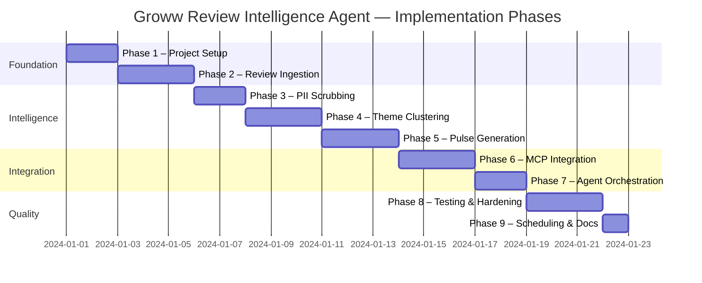
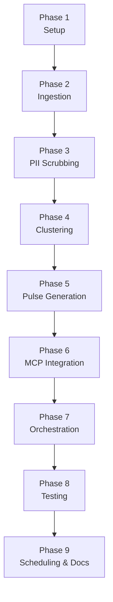

# Phase-Wise Implementation Plan
## Groww App Review Intelligence Agent

> **References:** [ProblemStatement.md](./ProblemStatement.md) · [Architecture.md](./Architecture.md)
>
> **Stack:** Python · Gemini/OpenAI LLM · MCP (Model Context Protocol) · Google Docs · Gmail
>
> **Principle:** Each phase is independently testable and delivers a working slice of the pipeline. The system is runnable end-to-end after Phase 7, with Phases 8–9 adding hardening and automation.

---

## Pipeline at a Glance

```
Play Store Reviews
      │
      ▼
[Phase 2] Ingestion ──────── Fetch + parse reviews (configurable window; real data shows ~400 reviews/3 days)
      │
      ▼
[Phase 3] PII Scrubbing ──── Strip emails, phones, UPI IDs, usernames
      │
      ▼
[Phase 4] Theme Clustering ── LLM groups reviews into ≤5 themes
      │
      ▼
[Phase 5] Pulse Generation ── Top 3 themes · 3 quotes · 3 actions · ≤250 words
      │
      ├──► [Phase 6A] Google Docs MCP ── Append pulse note to Doc (google_docs_append_text)
      │
      └──► [Phase 6B] Gmail MCP ──────── Send weekly pulse email (gmail_send_email)
```

---

## Phase Overview



---

## Phase 1 — Project Setup & Scaffolding

> **Goal:** Stand up the project skeleton, virtual environment, config, and logging utilities.

### Tasks

- [x] **1.1** Create the full folder structure from `Architecture.md §4`:
  ```
  AI Agent/
  ├── src/agent/   src/ingestion/   src/intelligence/   src/mcp/   src/utils/
  ├── tests/
  ├── config/
  └── Docs/
  ```
- [x] **1.2** Initialize Python virtual environment (`venv` or `conda`)
- [x] **1.3** Create `requirements.txt` with:

  | Package | Purpose |
  |---|---|
  | `google-generativeai` or `openai` | LLM client |
  | `google-play-scraper` | Play Store review fetching |
  | `mcp` | MCP Python SDK |
  | `pydantic` | Schema validation |
  | `python-dotenv` | Secrets management |
  | `pytest` + `pytest-mock` + `pytest-cov` | Testing |

- [x] **1.4** Create `config/settings.yaml` with all parameters from `Architecture.md §5`:

  | Parameter | Default |
  |---|---|
  | `review_window_weeks` | `10` |
  | `max_themes` | `5` |
  | `pulse_themes` | `3` |
  | `pulse_max_words` | `250` |
  | `quotes_per_pulse` | `3` |
  | `action_ideas_count` | `3` |
  | `min_review_length` | `20` |

- [x] **1.5** Implement `src/utils/config.py` — loads `settings.yaml`, exposes typed config values
- [x] **1.6** Implement `src/utils/logger.py` — structured JSON logging with configurable level
- [x] **1.7** Create `.env.example` documenting required environment variables (API keys, etc.)
- [x] **1.8** Add `.gitignore` (`.env`, `__pycache__`, `*.pyc`, `venv/`)

### Acceptance Criteria
- `python -c "from src.utils.config import settings; print(settings)"` prints all config values.
- Logger writes structured output to stdout.
- All directories from the architecture exist and are importable as packages (`__init__.py`).

### Files Produced
```
src/utils/config.py · src/utils/logger.py
config/settings.yaml · requirements.txt
.env.example · .gitignore
```

---

## Phase 2 — Review Ingestion

> **Goal:** Fetch real Groww Play Store reviews and normalize them into a typed schema.

> **Real Data Characteristics (from `groww_reviews.json`):**
> - **400 reviews** fetched over a ~3-day window (Oct 11–14, 2026)
> - **Average rating: 4.48/5** — distribution heavily skewed: 1★:37 · 2★:4 · 3★:9 · 4★:31 · 5★:319
> - **67.2% of reviews are short** (<20 chars) — most will be filtered by `min_review_length`
> - **19.2% non-ASCII** (Hindi, Tamil, Punjabi, Malayalam, etc.)
> - `thumbs_up` counts range from 0 to 504 — useful signal for quote selection

### Tasks

- [x] **2.1** Validate `google-play-scraper` is ToS-compliant (public data, no auth required)
- [x] **2.2** Implement `src/ingestion/fetcher.py`:
  ```python
  def fetch_reviews(app_id: str, weeks: int, lang: str = "en", country: str = "in") -> list[RawReview]
  ```
  - App ID: `com.nextbillion.groww`
  - Filter to reviews within the last `weeks` weeks using the `date` field
  - Support configurable max-review count per run
  - Note: high volume (~400 reviews/3 days) means pagination is critical for longer windows

- [x] **2.3** Implement `src/ingestion/parser.py` — map raw library output to:
  ```python
  class Review(BaseModel):
      id:        str
      rating:    int          # 1–5
      title:     str | None
      text:      str
      date:      datetime
      thumbs_up: int          # community upvotes — use for quote prioritisation
  ```
  > **Note:** `thumbs_up` field is present in real data and reaches 504 on popular reviews.
  > Use this as a signal in Phase 4/5 to surface the most resonant user quotes.

- [x] **2.4** Add pagination / count control (configurable `max_reviews`)
- [x] **2.5** Write `tests/test_ingestion.py` with mocked HTTP responses

### Acceptance Criteria
- Fetcher returns a list of `Review` objects with all fields populated, including `thumbs_up`.
- Reviews are correctly filtered to the configured time window.
- No credentials, API keys, or auth tokens in the ingestion path.

### Files Produced
```
src/ingestion/fetcher.py · src/ingestion/parser.py
tests/test_ingestion.py
```

---

## Phase 3 — Preprocessing & PII Scrubbing

> **Goal:** Strip all personally identifiable information from review text before it reaches the LLM.

> **Real Data Observations:**
> - **67.2% of reviews are <20 chars** — the `min_review_length` filter will remove the majority of records
> - **19.2% contain non-ASCII text** (Hindi in Devanagari, Tamil, Punjabi, Malayalam, etc.) — these must be handled explicitly
> - **Ticket/reference IDs** appear in complaint reviews (e.g. `Ticket ID 28133385`) — mask these
> - **Competitor app names** (Zerodha, Stoxkart) appear in negative reviews — preserve for analysis

### Tasks

- [x] **3.1** Implement `src/ingestion/scrubber.py` with these transformations:

  | Pattern | Replacement |
  |---|---|
  | Email addresses | `[email]` |
  | Indian phone numbers (10-digit, +91 prefix) | `[phone]` |
  | UPI IDs (`user@upi`) | `[upi_id]` |
  | Support ticket / reference IDs (e.g. `Ticket ID 28133385`) | `[ticket_id]` |
  | Device model strings | removed |
  | Reviewer display names | removed |
  | Excess whitespace / Unicode noise | normalized |

- [x] **3.2** Add minimum review length filter — drop reviews below `min_review_length` chars
  > **Expected impact:** ~67% of raw reviews will be filtered (validated against real data)

- [x] **3.3** Add language filter — decide policy for non-English reviews:
  - **Option A (Recommended):** Keep non-English reviews and rely on LLM multilingual understanding (Gemini handles Hindi/regional scripts natively)
  - **Option B:** Drop non-ASCII reviews (simpler, but loses ~19% of data including substantive Hindi complaints)
  - Document the chosen policy in `config/settings.yaml` as `non_english_policy: "keep" | "drop"`

- [x] **3.4** Expose a clean entry-point:
  ```python
  def scrub(reviews: list[Review]) -> list[Review]
  ```
- [x] **3.5** Write `tests/test_scrubber.py` covering: emails, phone numbers, UPI IDs, ticket IDs, short reviews, emoji-only reviews, Hindi/Devanagari text, mixed-script reviews

### Acceptance Criteria
- Reviews containing emails, phone numbers, or ticket IDs have those patterns masked.
- Reviews below minimum length are excluded (~67% in practice per real data).
- `rating`, `date`, and `thumbs_up` fields are preserved unchanged after scrubbing.
- Non-English policy is configurable and documented.
- Scrubber is always called before any LLM invocation.

### Files Produced
```
src/ingestion/scrubber.py · tests/test_scrubber.py
```

---

## Phase 4 — Theme Clustering

> **Goal:** Use an LLM to semantically group clean reviews into ≤ 5 named, ranked themes.

> **Expected Themes from Real Data (post-filter, substantive reviews):**
> Based on analysis of `groww_reviews.json`, the likely dominant themes are:
> 1. **UI/UX & Ease of Use** — largest positive cluster; users praise simple interface, beginner-friendliness
> 2. **Brokerage Charges & Fees** — top negative signal; ₹20/order flat fee, DP charges, lack of fee transparency
> 3. **Customer Service & Withdrawals** — repeated complaints about unresponsive support, withdrawal delays (3+ weeks)
> 4. **App Performance & Bugs** — order execution errors, app hanging/slow, chart settings reset after updates
> 5. **Features & Missing Functionality** — IPO autopay, US trading, 2FA options, index sorting, TradingView integration

### Tasks

- [x] **4.1** Set up LLM client in `src/intelligence/clusterer.py` (Gemini or OpenAI, via `.env`)
- [x] **4.2** Design the **clustering prompt**:
  - Input: batch of review texts
  - Instruction: assign each review to exactly one of ≤5 themes; infer theme names from data
  - Output: structured JSON with `theme_name` per review
  - Hint: prompt should handle mixed-language reviews gracefully (19% of Groww reviews are non-English)
- [x] **4.3** Implement batching to handle large review sets within LLM context limits
  > After filtering short reviews, expect ~130 substantive reviews from 400 raw (real data baseline)
- [x] **4.4** Implement `cluster(reviews: list[Review]) -> list[Theme]` producing:
  ```python
  class Theme(BaseModel):
      name:         str
      review_count: int
      reviews:      list[Review]
      sentiment:    str           # "positive" | "neutral" | "negative"
      top_quotes:   list[str]     # ≤3 verbatim, PII-free quotes — prefer high thumbs_up reviews
  ```
  > **Quote selection:** prioritise reviews with `thumbs_up > 0` as they represent community-validated sentiment
- [x] **4.5** Sort themes by `review_count` descending
- [x] **4.6** Enforce hard cap: if LLM returns > 5 themes, retry with a stricter prompt; raise `ValueError` if still exceeded
- [x] **4.7** Write `tests/test_clusterer.py` with mocked LLM responses

### Acceptance Criteria
- Output always contains ≤ 5 theme objects.
- Every review is assigned to exactly one theme.
- Themes are sorted by volume, highest first.
- LLM is never called with unscrubbed review text.

### Files Produced
```
src/intelligence/clusterer.py · tests/test_clusterer.py
```

---

## Phase 5 — Pulse Generation

> **Goal:** Assemble the final one-page weekly pulse note (≤ 250 words) from clustered themes.

### Tasks

- [x] **5.1** Implement `src/intelligence/pulse_generator.py`
- [x] **5.2** Select **top 3 themes** by `review_count`
- [x] **5.3** Select **1 verbatim quote per top theme** (3 total) — PII-free, sourced directly from scrubbed reviews
- [x] **5.4** Use LLM to generate **3 concrete action ideas** grounded in top theme summaries
- [x] **5.5** Assemble pulse using this template:
  ```
  # Groww Weekly Review Pulse — [Week of DATE]

  ## Top Themes
  1. [Theme 1] — N reviews
  2. [Theme 2] — N reviews
  3. [Theme 3] — N reviews

  ## What Users Are Saying
  > "[Quote 1]"
  > "[Quote 2]"
  > "[Quote 3]"

  ## Recommended Actions
  1. [Action Idea 1]
  2. [Action Idea 2]
  3. [Action Idea 3]
  ```
- [x] **5.6** Enforce ≤ 250-word limit:
  - Count words post-generation
  - Trim action ideas / theme descriptions if over limit (never trim quotes)
  - Log a warning if truncation occurs
- [x] **5.7** Return a `Pulse` object:
  ```python
  class Pulse(BaseModel):
      week_of:      date
      top_themes:   list[Theme]   # top 3
      quotes:       list[str]     # 3 verbatim quotes
      action_ideas: list[str]     # 3 action ideas
      body:         str           # formatted pulse ≤250 words
      word_count:   int
  ```
- [x] **5.8** Write `tests/test_pulse_generator.py`

> ✅ **Smoke-test checkpoint:** Run in `--dry-run` mode after this phase to validate the full intelligence layer before wiring MCP.

### Acceptance Criteria
- `body` is ≤ 250 words (enforced, not just targeted).
- Exactly 3 quotes, 3 action ideas, top 3 themes in every output.
- No invented quotes — each maps back to a real review in the input.
- Pulse renders correctly in both plain text and Markdown.

### Files Produced
```
src/intelligence/pulse_generator.py · tests/test_pulse_generator.py
```

---

## Phase 6 — MCP Integration (Google Workspace Server)

> **Goal:** Publish the weekly pulse and deliver notification via the user's custom Google Workspace MCP Server (`google-workspace-mcp`) — strictly adhering to MCP protocol standards with zero direct Google OAuth or REST API calls in application code.
>
> **Server Reference:**
> - **Live Server Endpoint:** `https://mcp-server-production-3be3.up.railway.app/`
> - **Source Repository:** [Jaya-product/MCP-Server](https://github.com/Jaya-product/MCP-Server.git)
> - **Protocol / Transport:** Streamable HTTP over SSE (`GET /sse` or `/mcp` stream + `POST /messages?sessionId={id}` JSON-RPC 2.0 messages) or `stdio`
> - **Security Scopes:** Least privilege (`https://www.googleapis.com/auth/gmail.send` and `https://www.googleapis.com/auth/documents`), zero PII logging
> - **Health Check:** `GET /health` returns `{"status":"healthy","name":"google-workspace-mcp","version":"1.0.0"}`

### Tools Provided by MCP Server

| Tool | Action | Input Parameters | Return Value | Notes |
|---|---|---|---|---|
| `google_docs_append_text` | Non-destructive append to Doc | `document_id` (str, req)<br>`text` (str, req)<br>`prepend_newline` (bool, opt, default: true)<br>`request_id` (str, opt) | `{ "success": true, "document_id": str, "characters_appended": int, "status": str }` | Guaranteed never to overwrite, delete, or replace existing document content (`endOfSegmentLocation`). |
| `gmail_send_email` | Outbound email dispatch | `to` (list[str], req)<br>`cc` (list[str], opt)<br>`bcc` (list[str], opt)<br>`subject` (str, req)<br>`body` (str, req)<br>`confirm_send` (bool, opt)<br>`request_id` (str, opt) | `{ "success": true, "message_id": str, "thread_id": str, "status": "Email sent" }` | Enforces two-phase confirmation policy if `REQUIRE_EMAIL_CONFIRMATION` is active; requires `confirm_send: true` to dispatch. |

---

### Tasks

#### Phase 6A — MCP Client Transport Layer (`src/mcp/client.py`)

- [x] **6.1** Verify live server health check via `GET https://mcp-server-production-3be3.up.railway.app/health`
- [x] **6.2** Implement `src/mcp/client.py`:
  - Connect to the MCP server via Streamable HTTP (SSE transport on `/sse` or `/mcp`)
  - Capture and track active session ID (`sessionId`) from the SSE handshake
  - Dispatch JSON-RPC 2.0 client requests (`tools/list`, `tools/call`) to `/messages?sessionId={id}`
  - Support optional Bearer API key (`Authorization: Bearer <MCP_API_KEY>` or query parameter `?apiKey=...`)
  - Expose clean interface:
    ```python
    class MCPClient:
        async def call_tool(self, name: str, arguments: dict) -> dict: ...
        async def list_tools(self) -> list[dict]: ...
    ```
  - Map protocol-level errors (`INVALID_ARGUMENT`, `CONFIRMATION_REQUIRED`, `REQUEST_TOO_LARGE`) to typed exceptions

#### Phase 6B — Google Docs Tool Adapter (`src/mcp/docs_tools.py`)

- [x] **6.3** Implement `src/mcp/docs_tools.py`:
  ```python
  def append_pulse_to_doc(
      doc_id: str,
      pulse: Pulse,
      client: MCPClient | None = None
  ) -> dict:
  ```
  - Format the weekly pulse into a clean, dated journal entry with horizontal rule separators and markdown formatting
  - Call `google_docs_append_text` with:
    - `document_id`: `doc_id` (from `settings.pulse_doc_id` or target URL)
    - `text`: formatted pulse entry
    - `prepend_newline`: `True`
    - `request_id`: unique UUID correlation ID
  - Return `{ "success": bool, "document_id": str, "characters_appended": int, "doc_url": str }`

#### Phase 6C — Gmail Tool Adapter (`src/mcp/gmail_tools.py`)

- [x] **6.4** Implement `src/mcp/gmail_tools.py`:
  ```python
  def send_pulse_email(
      recipient: str,
      pulse: Pulse,
      doc_url: str = "",
      confirm_send: bool = True,
      client: MCPClient | None = None
  ) -> dict:
  ```
  - Subject: `Groww Weekly Review Pulse — Week of {pulse.week_of}`
  - Body: Plain-text formatted pulse summary + footer pointer to Google Doc journal
  - Call `gmail_send_email` with:
    - `to`: `[recipient]`
    - `subject`: subject string
    - `body`: formatted body text
    - `confirm_send`: `True` (satisfies server two-phase confirmation requirement)
    - `request_id`: unique UUID to prevent duplicate email dispatches
  - Return `{ "success": bool, "message_id": str, "status": str }`

#### Phase 6D — Configuration & Testing

- [x] **6.5** Update configuration in `config/settings.yaml` and `.env.example`:
  ```yaml
  mcp_server_url: "https://mcp-server-production-3be3.up.railway.app"
  mcp_api_key: ""             # Optional Bearer token if configured on server
  pulse_doc_id: ""            # Existing Google Doc ID or URL where pulses are appended
  pulse_email_recipient: ""   # Target email address for weekly pulse distribution
  ```
- [x] **6.6** Implement comprehensive unit tests in `tests/test_mcp_client.py`:
  - Test MCP SSE client handshake, session capture, and message routing with mocked SSE server
  - Test `append_pulse_to_doc` payload construction and character verification
  - Test `send_pulse_email` parameter formatting, recipient list, and confirmation handling
  - Test error handling for invalid arguments, server unreachable, and confirmation rejections

---

### Acceptance Criteria
- `MCPClient` connects successfully to `https://mcp-server-production-3be3.up.railway.app/sse`.
- `append_pulse_to_doc` successfully appends the formatted pulse to the specified Google Doc without modifying existing content.
- `send_pulse_email` dispatches the pulse email with `confirm_send: true` and includes the Doc link.
- Zero raw Google OAuth or REST API code in the repo — all Workspace operations are strictly MCP tool calls.
- Unit tests in `tests/test_mcp_client.py` achieve ≥ 80% coverage with mocked transport.

### Files Produced
```
src/mcp/client.py · src/mcp/docs_tools.py · src/mcp/gmail_tools.py
tests/test_mcp_client.py
```

---

## Phase 7 — Agent Core (End-to-End Orchestration)

> **Goal:** Wire all components into a single runnable pipeline with a CLI entry point.

### Tasks

- [x] **7.1** Implement `src/agent/core.py`:
  ```python
  def run_pipeline():
      reviews   = fetch_reviews(app_id="com.nextbillion.groww", weeks=settings.review_window_weeks)
      clean     = scrub(reviews)
      themes    = cluster(clean)
      pulse     = generate_pulse(themes)
      doc_res   = append_pulse_to_doc(doc_id=settings.pulse_doc_id, pulse=pulse)
      email_res = send_pulse_email(recipient=settings.pulse_email_recipient, pulse=pulse, doc_url=settings.pulse_doc_id)
      logger.info("Pipeline complete", doc_res=doc_res, email_res=email_res)
  ```
- [x] **7.2** Add error handling and graceful degradation:

  | Failure Scenario | Response |
  |---|---|
  | MCP Docs unavailable | Log error; attempt Gmail draft with inline pulse |
  | Clustering returns 0 themes | Abort with clear error |
  | Fewer than 3 reviews fetched | Abort with warning (insufficient data) |
  | LLM returns malformed JSON | Retry with stricter prompt; fail after N retries |

- [x] **7.3** Add CLI entry point (`src/__main__.py`):
  ```bash
  python -m src.agent.core --weeks 10
  python -m src.agent.core --dry-run   # prints pulse to stdout, skips MCP
  ```
- [x] **7.4** Run a full end-to-end smoke test with real services

### Acceptance Criteria
- `python -m src.agent.core` runs without errors and appends to Google Doc + sends Gmail pulse email.
- `--dry-run` prints the pulse to terminal without touching Docs or Gmail.
- All phase failures are caught, logged, and surfaced with clear messages.

### Files Produced
```
src/agent/core.py · src/__main__.py
```

---

## Phase 8 — Testing & Hardening

> **Goal:** Achieve ≥ 80% test coverage and harden the pipeline against real-world edge cases.

### Tasks

- [x] **8.1** Achieve ≥ 80% unit test coverage across all `src/` modules (`pytest --cov=src`)
- [x] **8.2** Add integration test: mock Play Store → mock LLM → mock MCP → verify `Pulse` shape end-to-end
- [x] **8.3** Add edge case tests — **grounded in real `groww_reviews.json` data**:

  | Edge Case | Real Data Evidence | Expected Behaviour |
  |---|---|---|
  | Majority of reviews are very short (<20 chars) | 67.2% of raw reviews | Filtered by `min_review_length`; pipeline continues with substantive subset |
  | Mixed-language reviews (Hindi, Tamil, Malayalam) | 19.2% non-ASCII | Handled per configured `non_english_policy`; no crash on Devanagari/Tamil scripts |
  | Reviews are emoji-only or single-word | Observed: 👎🏻👎🏻, 😊, "wow" etc. | Filtered by `min_review_length` |
  | Rating vs. text mismatch (1★ with text "good appp") | Observed in data | Classified by text semantics, not rating alone |
  | Ticket / reference IDs in complaints | e.g. `Ticket ID 28133385` | Masked as `[ticket_id]` by scrubber |
  | High `thumbs_up` outlier on a single review | 504 thumbs on one review | Pipeline doesn't over-weight single viral review; sample across themes |
  | All substantive reviews fall into one theme | Possible if small filtered set | Pipeline completes; pulse reflects single dominant theme |
  | LLM returns malformed JSON | N/A (mocked) | Retry logic kicks in; fails cleanly after max retries |
  | MCP server unavailable | N/A | Graceful error with fallback behaviour |
  | Fewer than 3 substantive reviews post-filter | Possible in slow periods | Abort with warning: insufficient data for clustering |

- [x] **8.4** Enforce `pydantic` validation at every layer boundary — fail fast on bad data
- [x] **8.5** Add exponential backoff for LLM API rate limits
- [x] **8.6** Audit all log output — confirm zero PII leaks (including ticket IDs, phone numbers)
- [x] **8.7** Validate `thumbs_up`-based quote selection: assert no quote with `thumbs_up = 0` is chosen when higher-upvoted alternatives exist in the same theme

### Acceptance Criteria
- `pytest --cov=src` reports ≥ 80% coverage.
- All edge case tests pass.
- Log output confirmed PII-free via review (including ticket IDs).
- Quote selection favours community-validated reviews (`thumbs_up > 0`) when available.

---

## Phase 9 — Scheduling, Documentation & Handoff

> **Goal:** Make the pipeline production-ready with automated scheduling and developer documentation.

### Tasks

- [-] **9.1** Add weekly scheduling support (Skipped per user request; manual CLI & dry-run primary)
- [x] **9.2** Write `README.md` covering:
  - Project overview and pipeline diagram
  - Setup: clone, create venv, `pip install -r requirements.txt`, configure `.env`
  - Running manually: `python -m src` / `python -m src.agent.core`
  - Dry-run mode: `python -m src --dry-run`
  - Setting up MCP servers (Docs + Gmail)
  - Interactive dashboard server: `python -m src --serve`

- [x] **9.3** Document all environment variables in `.env.example` with descriptions and example values
- [x] **9.4** Final smoke test in a clean environment (fresh clone, fresh venv)

### Acceptance Criteria
- A new developer can follow `README.md` to run the pipeline from scratch with zero prior context.
- System is runnable end-to-end via CLI with comprehensive documentation and verified tests.

### Files Produced
```
README.md · .env.example (updated)
```

---

## Dependency Map



> **Smoke-test checkpoint after Phase 5:** Run `--dry-run` to validate the intelligence layer before wiring any MCP integrations.

---

## Risk Register

| Risk | Likelihood | Impact | Mitigation |
|---|---|---|---|
| `google-play-scraper` rate-limited / blocked | Medium | High | Add delay + backoff; cache fetched reviews locally |
| LLM returns > 5 themes or malformed JSON | Medium | Medium | Retry with stricter prompt; validate with pydantic |
| MCP server unavailable or misconfigured | Low | High | Graceful fallback; use `--dry-run` for validation |
| Pulse exceeds 250-word limit post-generation | Low | Low | Post-generation word count check + trim logic |
| PII leaks into quotes or LLM prompts | Low | High | Scrubber runs before any LLM call; log audit in Phase 8 |
| Too few substantive reviews after filtering (67% expected to be filtered) | Medium | Medium | Lower `min_review_length` threshold or widen date window; abort with warning if <10 reviews remain |
| Multilingual reviews (19% non-ASCII) cause LLM misclassification | Medium | Medium | Configure `non_english_policy`; test with real Hindi reviews from dataset |
| `thumbs_up` outlier (504 on single review) skews quote selection | Low | Low | Cap thumbs-weight contribution; sample across themes rather than sorting globally |
| Competitor names (Zerodha, Stoxkart) in reviews affect neutrality of pulse | Low | Low | Preserve competitor mentions as useful competitive signal; do not scrub |
| App version / OS complaints (e.g. Android OS compatibility) create transient theme spikes | Medium | Low | Add review date weighting; flag themes that are likely version-specific |

---

## Deliverable Checklist

| # | Deliverable | Phase | Status |
|---|---|---|---|
| 1 | Project scaffolding, config & logging utilities | 1 | ✅ |
| 2 | Play Store review fetcher + `thumbs_up`-aware schema | 2 | ✅ |
| 3 | PII scrubber (emails, phones, UPI IDs, ticket IDs) + multilingual policy | 3 | ✅ |
| 4 | LLM theme clusterer (≤ 5 themes, ranked, `thumbs_up`-weighted quotes) | 4 | ✅ |
| 5 | Weekly pulse generator (≤ 250 words, top 3 themes, 3 quotes, 3 actions) | 5 | ✅ |
| 6 | Google Docs MCP integration (google_docs_append_text via SSE) | 6 | ✅ |
| 7 | Gmail MCP integration (gmail_send_email with confirmation) | 6 | ✅ |
| 8 | End-to-end pipeline with CLI + dry-run mode | 7 | ✅ |
| 9 | Tests (≥ 80% coverage) + real-data edge case hardening | 8 | ✅ |
| 10 | Documentation (README + .env.example) & handoff | 9 | ✅ |
